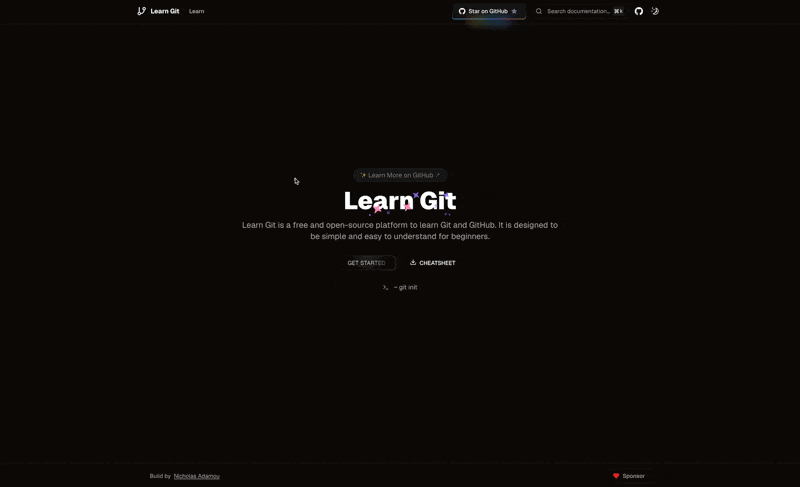

# Learn Git

[](https://github.com/smeltery/learn-git/actions/workflows/ci.yml)
[](https://github.com/smeltery/learn-git/releases)


[](https://flox.dev)
[](LICENSE)

Learn Git is a beginner-friendly guide to Git, with searchable lessons,
copyable commands, a downloadable cheat sheet, and light and dark themes.
Built with Next.js, TypeScript, Tailwind CSS, and MDX.



## Run locally

Install [Flox](https://flox.dev/docs/install-flox/), then:

```sh
git clone https://github.com/smeltery/learn-git.git
cd learn-git
flox activate
bun run dev
```

Open <http://localhost:3000>. Activation installs locked dependencies and
pre-commit hooks; `bun run ci` runs the checks and production build used by CI.

## Documentation

Start with the [documentation index](docs/README.md):
[using the guide](docs/using-the-guide.md), [local setup](docs/development.md),
[writing lessons](docs/content.md), [architecture](docs/architecture.md),
and [deployment and releases](docs/deployment.md).

## License

[PolyForm Shield License 1.0.0](LICENSE).
