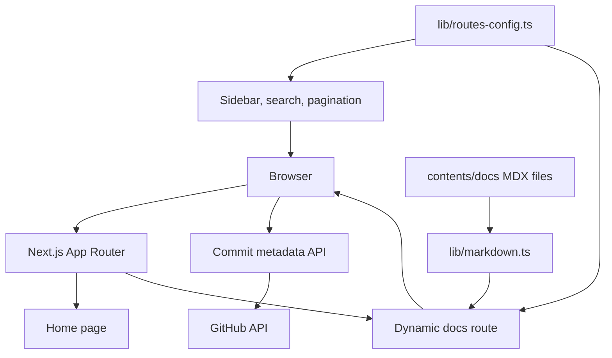

# Architecture

Learn Git is a single Next.js App Router application. It reads local MDX lessons
on the server and combines them with shared React navigation and UI components.
There is no database or account system.

| Location | Responsibility |
| --- | --- |
| `app/` | Pages, layouts, error boundaries, and commit API |
| `components/` | Navigation, Markdown renderers, and shared UI |
| `contents/docs/` | Git lessons and frontmatter |
| `lib/` | MDX compilation, routes, and helpers |
| `styles/` | Global and syntax styles |
| `public/` | Icons, cheat sheet, and generated service worker |
| `.flox/` | Reproducible tools and development service |
| `.github/` | Checks, dependency updates, and releases |

The MDX pipeline adds syntax highlighting, heading anchors, code titles, and
custom components. Route configuration supplies static generation parameters.
The PWA integration generates service-worker assets during builds. Vercel
Analytics and Speed Insights are included by the application layout.

See [content authoring](content.md) and [deployment](deployment.md) for workflows.
