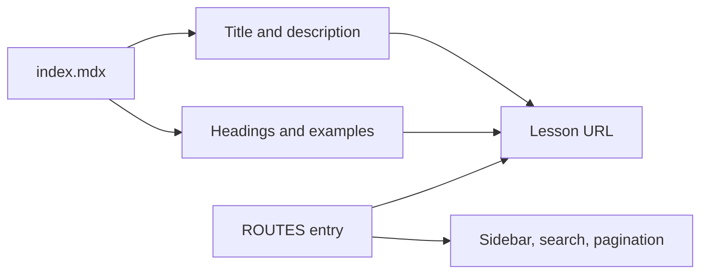

# Writing lessons

Lessons live at `contents/docs/<section>/<topic>/index.mdx`. Each lesson needs
frontmatter, followed by Markdown and optional supported MDX components:

```mdx
---
title: "Check repository status"
description: "See which files have changed."
---

## Inspect your work

Run `git status` from your repository directory.
```

Add the matching topic to `ROUTES` in `lib/routes-config.ts`. Nested `href` values
are combined to form the URL. For example, `/essential-commands` and `/git-status`
map to `/docs/essential-commands/git-status` and the corresponding content folder.
Route order controls sidebar, search, and previous/next navigation.



Use descriptive second-level headings for the table of contents and language
labels on fenced code blocks. Supported components are registered in
`lib/markdown.ts`, including `Note`, `Tabs`, `Files`, and `Stepper`. Follow a
nearby lesson's component usage.

Preview your lesson with `bun run dev`, check the exact URL, and run `bun run ci`.
Confirm that the title appears in search and navigation and that commands copy
correctly. A missing lesson file renders a 404 even when its route is listed in
navigation.

Repository guides belong in `docs/` and use ordinary Markdown. Mermaid diagrams
there render on GitHub and are syntax-checked in CI; the website's MDX pipeline
does not currently render Mermaid diagrams.
