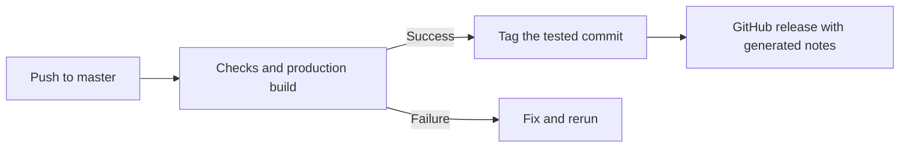

# Deployment and releases

## Run production

Inside Flox, run:

```sh
bun install --frozen-lockfile
bun run ci
bun run start
```

The production server listens on port 3000 by default. Use a Node.js host or a
Next.js-compatible platform such as Vercel; the commit API requires a server,
so a static-only host cannot provide every feature. Configure the host to use
Bun and the committed lockfile for installation and `bun run build` for builds.

Set `GITHUB_TOKEN` as a server-side host secret only if you need the footer commit
badge. The rest of the site does not require it. Keep build-generated service
workers out of source control; deploy the generated `public/` files with the app.

## Automatic releases



After a successful push build on `master`, `auto-release` creates the next patch
tag and publishes a GitHub release with generated notes. The first tag is
`v0.1.0`; subsequent tags increment the highest stable version's patch number.
These tags identify repository snapshots independently of `package.json`.

The workflow uses the successful run's exact commit, refuses stale runs after
`master` advances, and ignores pull-request and manual CI runs. Reruns reuse an
existing tag and skip a release that already exists. Releases contain GitHub's
automatic source archives; application deployment remains your hosting
provider's responsibility.

CI uses read-only repository access. Only automatic release publication receives
`contents: write`; CodeQL separately receives permission to upload findings.
Dependency update pull requests cover Bun packages and GitHub Actions.
