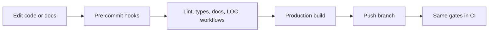

# Development

## Environment

Install [Flox](https://flox.dev/docs/install-flox/), clone the repository, and run
`flox activate` from its root. The committed manifest and lockfile provide Bun,
Node.js, pre-commit, and actionlint on macOS and Linux. Node runs Next.js; Bun
installs dependencies and runs project scripts.

Activation runs `bun install --frozen-lockfile` and installs Git hooks outside CI.
Start the site with `bun run dev`, or use `flox activate --start-services` to run
the declared `web` service. Inspect it with `flox services status` and stop it
with `flox services stop web`.

The site works without secrets. The footer's latest-commit badge requires a
server-side `GITHUB_TOKEN` in `.env.local`; without it the API returns an error
and the footer omits the badge. Never commit this file or expose the token with
a `NEXT_PUBLIC_` prefix.

## Checks

| Command | Purpose |
| --- | --- |
| `bun run check` | ESLint, TypeScript, Markdown, Mermaid, local links, LOC, workflows |
| `bun run build` | Production compilation and static page generation |
| `bun run verify` | Build and HTTP smoke checks for pages, PDF, and 404 |
| `bun run ci` | Checks, production build, and smoke checks |
| `pre-commit run --all-files` | Run the same two gates through Git hooks |
| `bun run hooks:install` | Reinstall hooks manually inside Flox |

Hooks run against the staged snapshot and can take as long as a production build.
Fix failures before committing. CI also runs CodeQL security analysis; that
hosted analysis has no local hook equivalent.

Markdown lint covers root Markdown and `docs/`. Mermaid syntax and relative file
links are validated in those same files. MDX lessons are compiled by Next.js;
they are not passed through plain Markdown lint because of their JSX syntax.

## Keep changes lean

The enforced budgets in `scripts/check-loc.ts` count nonblank lines: 4,000 for
application TypeScript and 100 for automation TypeScript. Generated files,
lockfiles, prose, and configuration are excluded. Prefer removing duplication
before raising a limit; explain any budget increase in the pull request.

Use `bun add` to change dependencies and commit `bun.lock` with `package.json`.
Use `flox update` to refresh environment packages and commit the Flox lockfile.
Run `bun run ci` after either change. CI installs with the frozen Bun lockfile.

If activation fails, check network access to Flox and package registries. If the
Bun lockfile is out of sync, run `bun install` intentionally and review its diff.

Tailwind 4 uses CSS configuration in `styles/globals.css` and its dedicated
PostCSS plugin. Use Safari 16.4+, Chrome 111+, or Firefox 128+ for the styling
features required by Tailwind 4.

Next.js uses Webpack explicitly because the service-worker plugin relies on it.
ESLint uses `eslint.config.mjs`. Type checks run TypeScript 7's native compiler;
TypeScript 6 remains installed for ESLint and Next.js compiler API compatibility.
Node type definitions stay aligned with the Flox Node 22 runtime.
