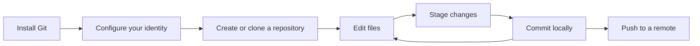

# Using the guide

Choose **Get Started** on the home page to open the introduction. Follow the
sidebar from installation through essential commands, or jump to a specific
topic with the search box. On macOS, Command+K opens search.

## Navigate and practice

- Use the sidebar or mobile navigation menu to choose a lesson.
- Search by lesson title; search does not index the full lesson text.
- Use the table of contents to jump between headings in a lesson.
- Copy commands with the copy button beside a code block. Replace example paths
  and repository names before running them in your terminal.
- Use the theme toggle to switch between light and dark appearances.
- Download the [Git cheat sheet](../public/git-cheatsheet.pdf) for quick reference.

Practice in a disposable repository while learning commands that change history.
The site explains commands; it does not run Git commands on your behalf.

## Troubleshooting

If a bookmarked lesson returns a 404, find the current lesson through the sidebar
or search. Contributors can check the route and content file using the
[content guide](content.md).

Clipboard access requires HTTPS or localhost and browser permission. If copying
fails, select and copy the command manually. If a previously visited page looks
outdated after a deployment, reload it or clear the site's stored browser data.
The service worker can cache assets, but offline access to every lesson is not
guaranteed.

Continue with [local setup](development.md) to run your own copy.
